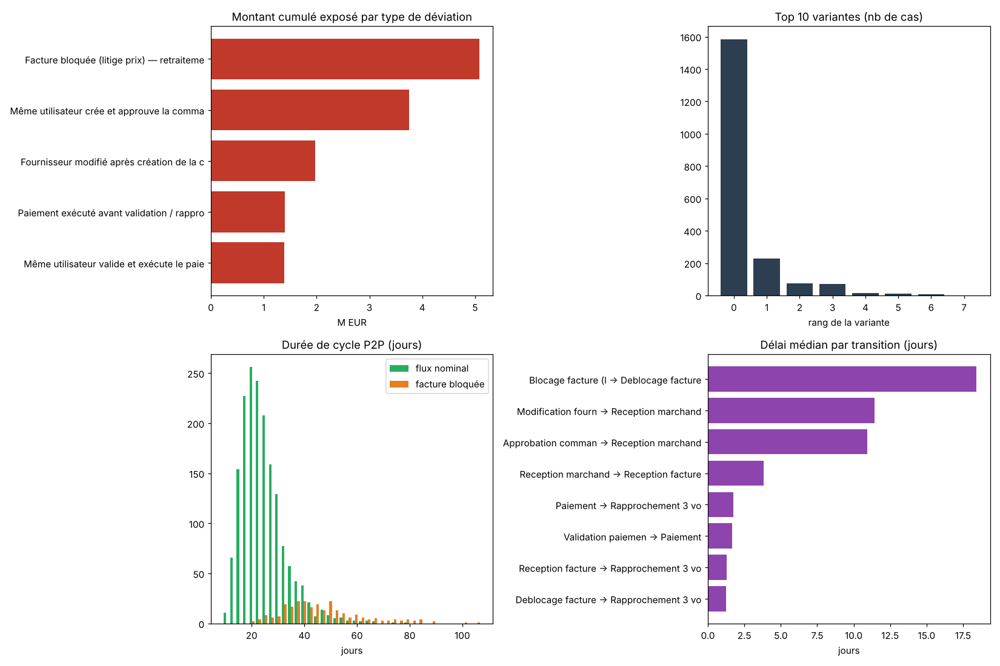
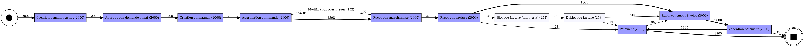

# Process mining d'un cycle achats (Purchase-to-Pay)

**Franck Nankeng** · [LinkedIn](https://www.linkedin.com/in/franck-nankeng-51b43b297/) · *[English summary below](#english-summary)*

Reconstituer le processus achats réellement exécuté à partir des traces du SI, le confronter au processus attendu et en tirer une note d'audit chiffrée. Le projet reproduit une revue de type audit SI sur un cycle Purchase-to-Pay, avec Python et PM4Py. Cas d'étude sur données simulées.



## En bref

| | |
|---|---|
| Population | 2 000 commandes, 18 618 événements, 35,3 M€ d'engagements, 12 mois |
| Découverte | Inductive miner, graphe des enchaînements (DFG), 8 variantes de processus |
| Conformité | Alignements contre le processus cible : fitness moyenne 0,979, 79,2 % des commandes parfaitement conformes |
| Règles métier | 5 tests indépendants : contrôle à trois voies, séparation des tâches (2 tests), fournisseur modifié, litiges de facturation |
| Résultat | 618 commandes déviantes (30,9 %), 11,73 M€ exposés (33,2 % des engagements) |
| Goulot | Une facture bloquée allonge le cycle de 22,8 à 43,6 jours en médiane, soit +20,8 jours |
| Livrables | Note d'audit en 4 constats, échantillon de 618 commandes priorisé par montant pour les tests de détail |

## Processus attendu

`Demande d'achat → Approbation DA → Création commande → Approbation commande → Réception marchandise → Réception facture → Rapprochement 3 voies → Validation paiement → Paiement`

Le contrôle clé du cycle est le rapprochement à trois voies (commande, réception, facture) avant tout paiement.

## Démarche

1. **Journal d'événements.** 2 000 commandes simulées avec utilisateur, montant et fournisseur, et quatre familles d'anomalies : paiement avant contrôle, fournisseur modifié après approbation, séparation des tâches non respectée, factures bloquées pour litige de prix. Les délais suivent une loi log-normale.
2. **Découverte du processus.** Inductive miner (modèle garanti sans blocage), graphe des enchaînements avec fréquences, analyse des variantes : une poignée de chemins couvre l'essentiel du volume, la queue longue concentre le risque.
3. **Conformité.** Alignements contre le modèle cible, puis traduction des écarts en cinq règles métier testables, chiffrées en nombre de commandes et en montant.
4. **Contrôle de la détection.** Comparaison avec la vérité terrain : quatre règles retrouvent exactement les cas injectés ; la règle de séparation des tâches sur le paiement remonte 21 faux positifs, analysés dans le notebook.
5. **Délais.** Médiane par transition et durée de cycle complète, pour chiffrer le goulot des litiges de facturation.
6. **Note d'audit.** Quatre constats avec risque et recommandation, et une appréciation d'ensemble.



## Les quatre constats

| Constat | Commandes | Montant | Recommandation |
|---|---|---|---|
| Paiement avant le rapprochement à trois voies | 95 (4,8 %) | 1,40 M€ | Bloquer techniquement le paiement sans statut « rapproché » dans l'ERP |
| Commande créée et approuvée par la même personne (et 76 cas sur le paiement) | 208 (10,4 %) | 3,75 M€ | Revoir la matrice des rôles, interdire l'auto-approbation |
| Fournisseur modifié après approbation de la commande | 102 (5,1 %) | 1,97 M€ | Réapprobation obligatoire et piste d'audit sur la table fournisseurs |
| Factures bloquées pour litige de prix | 258 (12,9 %) | 5,08 M€ | Analyse des causes racines et seuil de tolérance automatique |

Les trois premiers constats relèvent de la conception des contrôles applicatifs, pas de leur exécution : ils appellent une remédiation dans l'ERP plutôt qu'un rappel des procédures.

## Contenu du dépôt

```
process_mining_achats_p2p.ipynb   notebook exécuté : génération, découverte, conformité, délais, note d'audit
out/event_log_p2p.csv             journal d'événements (18 618 lignes)
out/ground_truth.csv              anomalies injectées, pour contrôler la détection
out/echantillon_tests_detail.csv  618 commandes à tester, triées par montant
out/*.png                         modèle découvert, modèle attendu, graphe des enchaînements, synthèse
requirements.txt
```

## Relancer le projet

```bash
pip install -r requirements.txt
# Graphviz est nécessaire pour les visuels de PM4Py (par exemple : apt-get install graphviz)
jupyter notebook process_mining_achats_p2p.ipynb
```

Le notebook régénère le journal d'événements à l'identique (graine fixée), puis tous les résultats dans `out/`.

PM4Py est distribué sous licence AGPL v3 : un usage commercial en interne suppose soit de publier le code, soit une licence commerciale.

## Outils

Python (pandas, NumPy, Matplotlib), PM4Py (inductive miner, DFG, alignements), Graphviz.

---

## English summary

Process mining applied to a simulated Purchase-to-Pay audit, in Python with PM4Py.

- **Population:** 2,000 purchase orders, 18,618 events, €35.3M of commitments over 12 months.
- **Discovery:** inductive miner, directly-follows graph and variant analysis (8 variants).
- **Conformance:** alignment-based checking against the target process (average fitness 0.979, 79.2% fully compliant), then five independent business-rule tests: three-way match bypass, two segregation-of-duties tests, supplier changes after approval, invoice disputes.
- **Result:** 618 deviating orders (30.9%) and €11.73M exposed (33.2% of commitments). Invoice disputes stretch the median cycle from 22.8 to 43.6 days (+20.8 days).
- **Deliverables:** a four-finding audit memo with risks and recommendations, and a sample of 618 orders ranked by amount for detailed testing.
